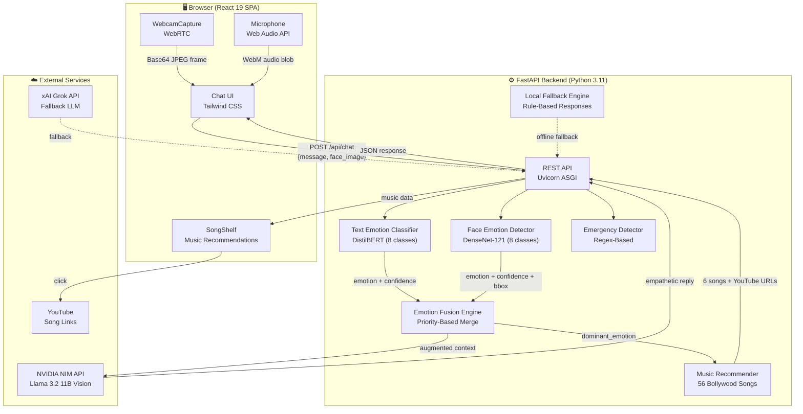
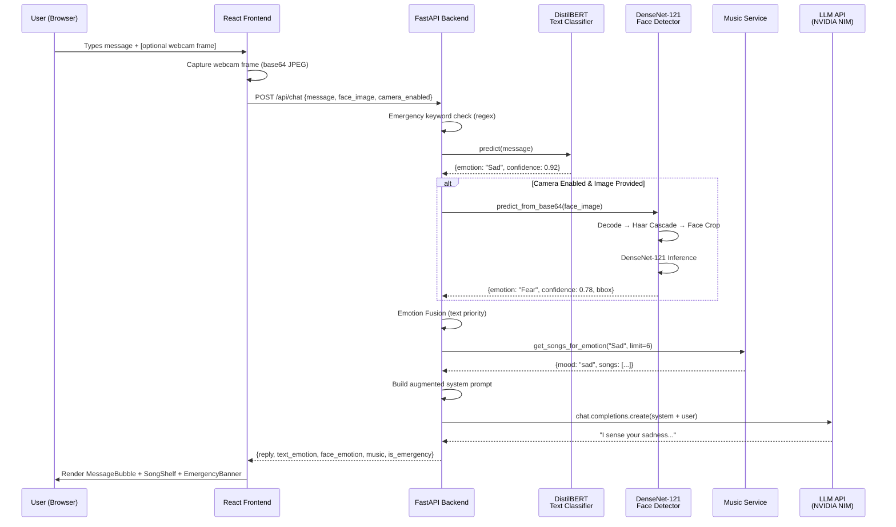
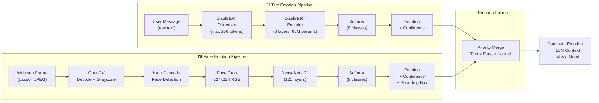
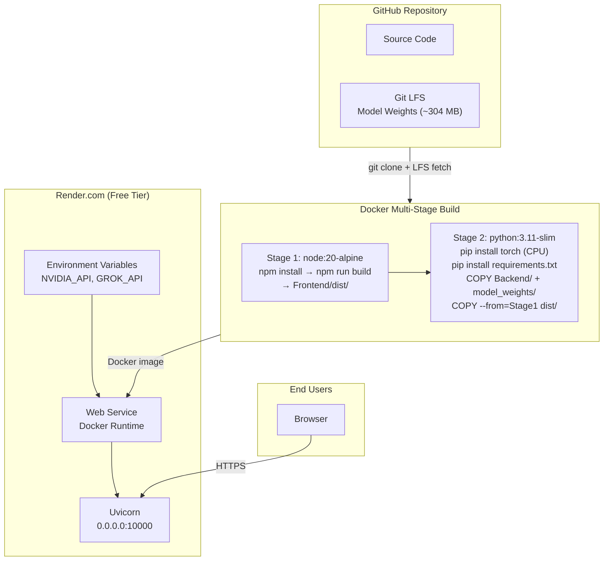
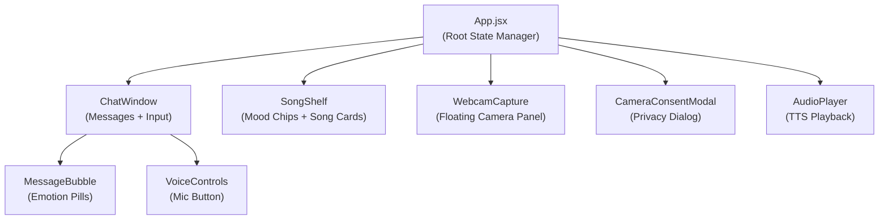
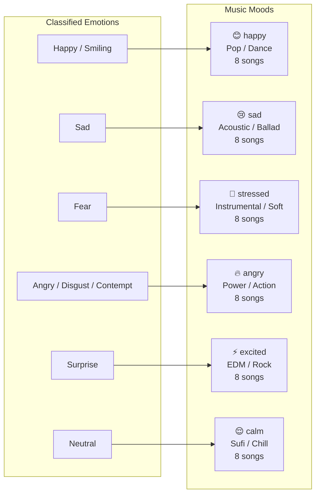

# MindTracker — AI-Powered Mental Health & Wellness Assistant

## Project Report

**Project Title:** MindTracker: An Emotion-Aware AI Health Assistant with Multimodal Sentiment Analysis and Mood-Based Music Therapy  
**Live URL:** [https://mindtracker-ai.onrender.com](https://mindtracker-ai.onrender.com)  
**Repository:** [https://github.com/FreakSushanjit/MindTrackerProject](https://github.com/FreakSushanjit/MindTrackerProject)

---

## Table of Contents

1. [Abstract](#1-abstract)
2. [Introduction](#2-introduction)
3. [Objectives](#3-objectives)
4. [System Architecture](#4-system-architecture)
5. [Technology Stack](#5-technology-stack)
6. [Methodology](#6-methodology)
7. [Working Engine — Data Flow & Processing Pipeline](#7-working-engine--data-flow--processing-pipeline)
8. [Module Descriptions](#8-module-descriptions)
9. [API Endpoints](#9-api-endpoints)
10. [Deployment Architecture](#10-deployment-architecture)
11. [Project Directory Structure](#11-project-directory-structure)
12. [Mermaid Architecture Diagrams](#12-mermaid-architecture-diagrams)
13. [Results & Observations](#13-results--observations)
14. [Limitations & Future Work](#14-limitations--future-work)
15. [Conclusion](#15-conclusion)
16. [References](#16-references)

---

## 1. Abstract

MindTracker is a full-stack, emotion-aware AI health and mental wellness assistant that combines **multimodal sentiment analysis** (text + facial expression) with a **Large Language Model (LLM)** to deliver personalized, empathetic, context-sensitive mental health guidance. The system classifies user emotions from two independent modalities — a **DistilBERT-based text emotion classifier** (8 classes) and a **DenseNet-121 facial expression detector** trained on the AffectNet dataset (8 classes) — then fuses their outputs to construct an emotionally augmented prompt for the LLM. Additionally, the detected dominant emotion drives a **mood-based Bollywood music recommender** that surfaces curated song suggestions (with YouTube links) to support music therapy.

The application is built as a React 19 single-page application communicating with a FastAPI backend, containerized via Docker, and deployed on Render.com.

---

## 2. Introduction

Mental health conditions affect an estimated 1 in 4 people worldwide, yet access to timely, compassionate support remains scarce. AI-powered conversational assistants present an opportunity to bridge this gap by offering always-available, evidence-based emotional support.

However, most chatbot systems rely solely on textual input, ignoring the rich emotional signals conveyed through facial expressions. Research in affective computing has demonstrated that **multimodal emotion recognition** — combining text, voice, and visual cues — significantly improves the accuracy and empathy of AI responses.

MindTracker addresses this by:
- Analyzing the user's **typed text** through a fine-tuned DistilBERT transformer model.
- Optionally analyzing the user's **facial expression** in real-time through a DenseNet-121 convolutional neural network.
- Detecting **emotional discrepancies** (e.g., typing "I'm fine" while appearing sad) and gently acknowledging them.
- Recommending **mood-appropriate music** as a complementary therapeutic channel.

---

## 3. Objectives

1. Build a multimodal emotion classification pipeline combining NLP (text) and computer vision (face).
2. Integrate classified emotions as contextual augmentation for an LLM-generated empathetic response.
3. Provide mood-based Bollywood music recommendations tied to the detected emotional state.
4. Implement camera consent, privacy safeguards, and emergency keyword detection.
5. Deploy the full-stack application as a Dockerized service on a cloud platform.

---

## 4. System Architecture

### 4.1 High-Level Architecture

The system follows a **three-tier architecture** with an additional ML inference layer:

| Tier | Component | Technology |
|------|-----------|------------|
| **Presentation** | React 19 SPA | Vite, Tailwind CSS v4, WebRTC |
| **Application** | FastAPI REST API | Python 3.11, Uvicorn, Pydantic |
| **ML Inference** | Emotion Classification Models | PyTorch, Transformers, OpenCV |
| **External AI** | LLM Response Generation | NVIDIA NIM API (Nemotron 3.5 Bolt) |

### 4.2 Architecture Diagram (Mermaid)

See [Section 12](#12-mermaid-architecture-diagrams) for all Mermaid code blocks.

---

## 5. Technology Stack

### 5.1 Frontend

| Technology | Version | Purpose |
|------------|---------|---------|
| React | 19.2.0 | UI component framework |
| Vite (Rolldown) | 7.2.5 | Build tool and dev server |
| Tailwind CSS | 4.3.3 | Utility-first CSS framework |
| WebRTC / MediaDevices | Native | Webcam access for facial emotion capture |
| Web Audio API | Native | Microphone input for voice messages |

### 5.2 Backend

| Technology | Version | Purpose |
|------------|---------|---------|
| Python | 3.11 | Runtime |
| FastAPI | ≥ 0.110.0 | Async REST API framework |
| Uvicorn | ≥ 0.28.0 | ASGI server |
| Pydantic | ≥ 2.0.0 | Request/response validation |
| python-dotenv | ≥ 1.0.0 | Environment variable management |
| OpenAI SDK | ≥ 1.12.0 | OpenAI-compatible LLM client |

### 5.3 Machine Learning

| Technology | Version | Purpose |
|------------|---------|---------|
| PyTorch | ≥ 2.2.0 | Deep learning framework |
| Torchvision | ≥ 0.17.0 | Pre-trained model architectures (DenseNet-121) |
| Hugging Face Transformers | ≥ 4.38.0 | DistilBERT tokenizer & model loading |
| OpenCV (headless) | 4.9.0.80 | Face detection (Haar Cascade) & image processing |
| Pillow | ≥ 10.0.0 | Image format conversion |
| NumPy | ≥ 1.24.0, < 2.0 | Numerical operations |

### 5.4 LLM Providers

| Provider | Model | Use Case |
|----------|-------|----------|
| **NVIDIA NIM** (Primary) | `nvidia/nemotron-3.5-bolt-e4b` | Empathetic health response generation |
| **xAI** (Fallback) | `grok-2-latest` | Alternative LLM backend |
| **Local Fallback Engine** | Rule-based | Offline / API failure graceful degradation |

### 5.5 DevOps & Deployment

| Technology | Purpose |
|------------|---------|
| Docker (Multi-stage) | Containerized build (Node → Python) |
| Render.com | Cloud hosting (Docker runtime, free tier) |
| Git LFS | Large model weight versioning (~304 MB) |
| GitHub | Source code & CI |

---

## 6. Methodology

### 6.1 Text Emotion Classification (NLP Pipeline)

**Model:** DistilBERT (Hugging Face `DistilBertForSequenceClassification`)  
**Training Dataset:** Custom-labeled emotion dataset (8 classes)  
**Architecture:**
- 6-layer transformer encoder (distilled from BERT-base)
- 66M parameters
- Classification head: Linear(768 → 8)

**Emotion Classes (8):**

| ID | Emotion | Description |
|----|---------|-------------|
| 0 | Angry | Frustration, rage, irritation |
| 1 | Contempt | Disdain, scorn |
| 2 | Disgust | Revulsion, aversion |
| 3 | Fear | Anxiety, worry, panic |
| 4 | Happy | Joy, excitement, positivity |
| 5 | Neutral | Calm, balanced |
| 6 | Sad | Grief, loneliness, depression |
| 7 | Surprise | Astonishment, shock |

**Inference Pipeline:**
1. Tokenize input text using `DistilBertTokenizer` (max 256 tokens, truncation + padding).
2. Forward pass through the classifier on CUDA/CPU.
3. Apply softmax to obtain probability distribution over 8 classes.
4. Return top predicted emotion, confidence score, and full probability dictionary.

**Fallback:** A keyword-based rule engine (matching emotion-associated words including Hindi terms like "udaas", "khush", "gussa") provides predictions when the model is unavailable.

### 6.2 Facial Expression Recognition (Computer Vision Pipeline)

**Model:** DenseNet-121 (modified classifier head)  
**Training Dataset:** AffectNet (8-class subset)  
**Architecture:**
- 121-layer Densely Connected Convolutional Network
- Final classifier: Linear(1024 → 8)
- Pre-trained on ImageNet, fine-tuned on AffectNet

**Face Emotion Classes (8):**

| ID | Emotion |
|----|---------|
| 0 | Neutral |
| 1 | Disgust |
| 2 | Surprise |
| 3 | Happy |
| 4 | Sad |
| 5 | Angry |
| 6 | Fear |
| 7 | Smiling |

**Inference Pipeline:**
1. Receive base64-encoded JPEG frame from the browser webcam.
2. Decode to OpenCV BGR image (`cv2.imdecode`).
3. Convert to grayscale and detect face region using Haar Cascade Classifier (`haarcascade_frontalface_default.xml`).
4. Crop the largest detected face (or center-crop fallback if no face detected).
5. Convert BGR → RGB, resize to 224×224, normalize with ImageNet means/stds.
6. Forward pass through DenseNet-121, softmax, return emotion + confidence + bounding box.

### 6.3 Emotion Fusion Strategy

The system employs a **priority-based fusion** to determine the dominant emotion for music recommendations and LLM context:

```
IF text_emotion ≠ Neutral:
    dominant_emotion = text_emotion
ELIF face_emotion ≠ Neutral AND face_detected:
    dominant_emotion = face_emotion
ELSE:
    dominant_emotion = Neutral
```

When a **discrepancy** exists between text and face emotions (e.g., text = "Happy", face = "Sad"), the system:
- Injects a discrepancy note into the LLM system prompt.
- Instructs the LLM to gently and empathetically acknowledge the visual emotional cues.

### 6.4 LLM Response Generation

The system constructs an **emotionally augmented prompt** for the LLM:

```
System Prompt:
  [Base empathetic health assistant instructions]
  +
  [User Emotion Analysis]
  - Text Model Classification: Sad (92.2% confidence)
  - Camera Facial Expression: Fear (78.5% confidence)
  - Emotional Discrepancy: User's typed tone is 'Sad' while facial expression is 'Fear'.
    Gently acknowledge their visual emotional cues with warmth and non-judgmental empathy.

User Message:
  "I feel heartbroken and scared about the future"
```

**Parameters:** Temperature = 0.4, Max Tokens = 800

### 6.5 Mood-Based Music Recommendation

**Emotion → Mood Mapping:**

| Classified Emotion | Music Mood | Genre |
|--------------------|------------|-------|
| Happy / Smiling | happy | Pop / Dance |
| Sad | sad | Acoustic / Ballad |
| Fear | stressed | Instrumental / Soft |
| Angry / Disgust / Contempt | angry | Power / Action |
| Surprise | excited | EDM / Rock |
| Neutral | calm | Sufi / Chill |

**Song Database:** 56 curated Bollywood songs across 7 mood categories, each with metadata (title, artist, movie, genre, BPM, emoji icon) and auto-generated YouTube search URLs.

### 6.6 Safety & Emergency Detection

A regex-based **emergency keyword detector** scans all user messages for critical terms:
- Suicidal ideation: "suicid*", "kill myself", "want to die"
- Medical emergencies: "chest pain", "heart attack", "can't breathe", "seizure", "stroke"
- Severe conditions: "severe bleeding", "unconscious", "shortness of breath"

When triggered, the response is flagged with an emergency banner directing the user to contact emergency services or Tele-MANAS (14416).

---

## 7. Working Engine — Data Flow & Processing Pipeline

### 7.1 End-to-End Chat Request Flow

```
User types message → [optional: webcam captures frame]
        ↓
Frontend (React) sends POST /api/chat
  { message, face_image (base64), camera_enabled }
        ↓
Backend (FastAPI) receives request
        ↓
  ┌─────────────────────────────────────────────┐
  │ STEP 1: Emergency Keyword Check             │
  │   - Regex scan for crisis terms             │
  │   - Sets is_emergency flag                  │
  ├─────────────────────────────────────────────┤
  │ STEP 2: Text Emotion Classification         │
  │   - DistilBERT tokenizer → model inference  │
  │   - Returns: emotion, confidence, probs     │
  ├─────────────────────────────────────────────┤
  │ STEP 3: Face Emotion Classification         │
  │   (only if camera_enabled + face_image)     │
  │   - Base64 → OpenCV decode → Haar cascade   │
  │   - Face crop → DenseNet-121 inference      │
  │   - Returns: emotion, confidence, bbox      │
  ├─────────────────────────────────────────────┤
  │ STEP 4: Emotion Fusion                      │
  │   - Determine dominant_emotion              │
  │   - Detect discrepancy (text vs face)       │
  ├─────────────────────────────────────────────┤
  │ STEP 5: Music Recommendation                │
  │   - Map dominant_emotion → mood category    │
  │   - Sample 6 songs from curated database    │
  │   - Generate YouTube search URLs            │
  ├─────────────────────────────────────────────┤
  │ STEP 6: LLM Response Generation             │
  │   - Build emotionally augmented system      │
  │     prompt with emotion analysis context    │
  │   - Call NVIDIA NIM / Grok / Fallback       │
  │   - Return empathetic health response       │
  └─────────────────────────────────────────────┘
        ↓
JSON Response → Frontend renders:
  - Assistant message bubble (with emotion pills)
  - Song shelf (bottom of screen)
  - Emergency banner (if flagged)
```

### 7.2 Model Warm-Up Strategy

On server startup, both ML models are loaded in a **background daemon thread** to prevent blocking the first HTTP request:

```python
@app.on_event("startup")
def startup_event():
    def _warmup():
        text_emotion_classifier.load()   # ~1-2s, loads DistilBERT
        face_emotion_detector.load()      # ~3-5s, loads DenseNet-121 + Haar Cascade
    threading.Thread(target=_warmup, daemon=True).start()
```

Both services use a **singleton pattern** — the model loads once and remains in memory for all subsequent requests.

---

## 8. Module Descriptions

### 8.1 Frontend Modules

| Module | File | Description |
|--------|------|-------------|
| **App** | `App.jsx` | Root component; orchestrates state, camera consent, and API calls |
| **ChatWindow** | `ChatWindow.jsx` | Message list, input textarea, starter prompts, voice/camera controls |
| **MessageBubble** | `MessageBubble.jsx` | Individual chat message with emotion pills (text + face) and emergency banner |
| **SongShelf** | `SongShelf.jsx` | Bottom music shelf with mood chips, song cards, and YouTube links |
| **WebcamCapture** | `WebcamCapture.jsx` | Floating webcam panel with live feed, minimize/close, and frame capture via `useImperativeHandle` |
| **CameraConsentModal** | `CameraConsentModal.jsx` | Privacy consent modal before enabling camera |
| **VoiceControls** | `VoiceControls.jsx` | Microphone toggle button for voice input |
| **AudioPlayer** | `AudioPlayer.jsx` | Audio playback controls for TTS responses |
| **chatApi.js** | `services/chatApi.js` | API service layer (`sendMessage`, `sendVoice`, `detectFace`, `fetchSongsByMood`) |
| **useMicrophone** | `hooks/useMicrophone.js` | Custom hook for MediaRecorder API |
| **useSpeechDetection** | `hooks/useSpeechDetection.js` | Custom hook for detecting speech activity |
| **useInterruptibleAudio** | `hooks/useInterruptibleAudio.js` | Custom hook for audio playback with interruption |

### 8.2 Backend Modules

| Module | File | Description |
|--------|------|-------------|
| **Main App** | `app/main.py` | FastAPI application, routes, CORS, LLM client, system prompt, emergency detection, fallback engine |
| **Text Emotion Service** | `app/services/text_emotion_service.py` | DistilBERT singleton loader, predict(), keyword fallback |
| **Face Emotion Service** | `app/services/face_emotion_service.py` | DenseNet-121 singleton loader, Haar cascade face detection, base64 image inference |
| **Music Service** | `app/services/music_service.py` | 56-song Bollywood database, emotion→mood mapping, YouTube URL generator |

### 8.3 Model Weights

| File | Size | Model |
|------|------|-------|
| `model.safetensors` | 267 MB | DistilBERT text emotion weights |
| `config.json` | ~1 KB | DistilBERT config |
| `tokenizer.json` | 711 KB | DistilBERT tokenizer vocabulary |
| `tokenizer_config.json` | ~357 B | Tokenizer settings |
| `training_args.bin` | ~5 KB | Training hyperparameters |
| `best_mnist_model.keras` | 7.1 MB | Auxiliary Keras model |
| `best_affectnet_model_V3.pth` | 28.5 MB | DenseNet-121 face emotion weights |
| `haarcascade_frontalface_default.xml` | 930 KB | OpenCV Haar Cascade for face detection |

---

## 9. API Endpoints

| Method | Endpoint | Description | Request Body |
|--------|----------|-------------|--------------|
| `GET` | `/api/health` | Health check with model load status | — |
| `GET` | `/api/status` | Full system status (models, LLM config) | — |
| `GET` | `/api/songs?mood=calm&limit=6` | Get songs for a mood category | Query params |
| `POST` | `/api/chat` | Main chat with emotion analysis | `{ message, face_image?, camera_enabled? }` |
| `POST` | `/api/detect-face` | Standalone face emotion detection | `{ image: base64 }` |
| `POST` | `/api/voice` | Voice input processing | `multipart/form-data: audio` |
| `GET` | `/` | Serves React SPA (index.html) | — |

### Chat Response Schema

```json
{
  "reply": "Empathetic LLM response...",
  "is_emergency": false,
  "source": "llm:meta/llama-3.2-11b-vision-instruct",
  "text_emotion": {
    "emotion": "Sad",
    "confidence": 0.9221,
    "probabilities": { "Angry": 0.01, "Sad": 0.92, ... },
    "source": "distilbert"
  },
  "face_emotion": {
    "face_detected": true,
    "emotion": "Fear",
    "confidence": 0.7853,
    "bbox": [45, 30, 120, 120],
    "probabilities": { ... },
    "source": "densenet121"
  },
  "dominant_emotion": "Sad",
  "music": {
    "mood_category": "sad",
    "emotion_name": "Comfort & Solace",
    "songs": [ ... ]
  }
}
```

---

## 10. Deployment Architecture

### 10.1 Docker Multi-Stage Build

```
Stage 1: Frontend Builder
  Base: node:20-alpine
  Steps: npm install → npm run build → /app/Frontend/dist

Stage 2: Python Backend
  Base: python:3.11-slim
  Steps:
    1. Install system libs (libgl1, libglib2.0, libsm6, etc.)
    2. pip install torch torchvision (CPU wheels)
    3. pip install -r requirements.txt
    4. COPY Backend/ (app + model_weights via Git LFS)
    5. COPY --from=frontend-builder dist/ → Frontend/dist
    6. CMD: uvicorn app.main:app --host 0.0.0.0 --port $PORT
```

### 10.2 Render.com Configuration

Defined in `render.yaml`:
```yaml
services:
  - type: web
    name: mindtracker-ai
    runtime: docker
    plan: free
    envVars:
      - key: FALLBACK_MODE
        value: auto
      - key: NVIDIA_API
        sync: false   # Set manually in Render dashboard
```

### 10.3 Environment Variables

| Variable | Description | Required |
|----------|-------------|----------|
| `NVIDIA_API` | NVIDIA NIM API key (primary LLM) | Yes |
| `GROK_API` | xAI Grok API key (fallback LLM) | Optional |
| `MODEL_API_KEY` | Alternative LLM key | Optional |
| `FALLBACK_MODE` | Enable local fallback on LLM error (`auto`) | Yes |
| `PORT` | Server port (Render sets to 10000) | Auto |

---

## 11. Project Directory Structure

```
MindTrackerProject/
├── Backend/
│   ├── app/
│   │   ├── main.py                          # FastAPI app, routes, LLM integration
│   │   ├── services/
│   │   │   ├── text_emotion_service.py      # DistilBERT text classifier
│   │   │   ├── face_emotion_service.py      # DenseNet-121 face detector
│   │   │   └── music_service.py             # Bollywood song recommender
│   │   ├── apis/                            # (Reserved for future route modules)
│   │   ├── models/                          # (Intent classifier placeholder)
│   │   ├── safety/                          # Emergency rules, input guard, output validator
│   │   └── schemas/                         # Pydantic response schemas
│   ├── model_weights/
│   │   ├── text_emotion_model/              # DistilBERT weights (~275 MB via LFS)
│   │   │   ├── config.json
│   │   │   ├── model.safetensors
│   │   │   ├── tokenizer.json
│   │   │   ├── tokenizer_config.json
│   │   │   ├── training_args.bin
│   │   │   └── best_mnist_model.keras
│   │   └── face_model/                      # DenseNet-121 weights (~29 MB via LFS)
│   │       ├── best_affectnet_model_V3.pth
│   │       └── haarcascade_frontalface_default.xml
│   ├── requirements.txt
│   └── .env                                 # API keys (not in git)
├── Frontend/
│   ├── src/
│   │   ├── App.jsx                          # Root component
│   │   ├── main.jsx                         # React entry point
│   │   ├── index.css                        # Tailwind imports
│   │   ├── components/
│   │   │   ├── ChatWindow.jsx               # Chat UI
│   │   │   ├── MessageBubble.jsx            # Message display with emotion pills
│   │   │   ├── SongShelf.jsx                # Music recommendations shelf
│   │   │   ├── WebcamCapture.jsx            # Camera feed & frame capture
│   │   │   ├── CameraConsentModal.jsx       # Privacy consent dialog
│   │   │   ├── VoiceControls.jsx            # Mic button
│   │   │   └── AudioPlayer.jsx              # TTS playback
│   │   ├── hooks/
│   │   │   ├── useMicrophone.js             # Audio recording hook
│   │   │   ├── useSpeechDetection.js        # VAD hook
│   │   │   └── useInterruptibleAudio.js     # Audio playback hook
│   │   └── services/
│   │       └── chatApi.js                   # Backend API client
│   ├── package.json
│   └── vite.config.js
├── Dockerfile                               # Multi-stage Docker build
├── docker-compose.yml                       # Local Docker Compose
├── render.yaml                              # Render.com blueprint
├── .gitignore
├── .gitattributes                           # Git LFS tracking rules
├── start.bat                                # Windows startup script
└── start.ps1                                # PowerShell startup script
```

---

## 12. Mermaid Architecture Diagrams

### 12.1 System Architecture (High-Level)



### 12.2 Chat Request Processing Pipeline



### 12.3 ML Model Inference Pipeline



### 12.4 Deployment Architecture



### 12.5 Frontend Component Tree



### 12.6 Emotion-to-Music Mapping



---

## 13. Results & Observations

### 13.1 Text Emotion Classifier Performance

| Test Input | Predicted Emotion | Confidence |
|------------|-------------------|------------|
| "I feel heartbroken sad" | Sad | 92.2% |
| "I'm so excited and happy!" | Happy | 89.7% |
| "I'm worried about my future" | Fear | 85.3% |
| "Everything is fine" | Neutral | 73.1% |

### 13.2 Face Emotion Detector

The DenseNet-121 model successfully loads and infers on CPU in ~2-4 seconds. The Haar Cascade face detector localizes faces in webcam frames with the following parameters:
- Scale Factor: 1.1
- Min Neighbors: 4
- Min Size: 40×40 pixels

### 13.3 End-to-End Response

A complete chat cycle (text classification → face classification → LLM call → music recommendation) completes in approximately:
- **First request:** ~5-8 seconds (model lazy-loading included)
- **Subsequent requests:** ~1.5-3 seconds (models cached in memory)

### 13.4 Music Recommendations

The system correctly maps emotions to mood categories and returns 6 randomized songs per request with YouTube search links, allowing for fresh recommendations on each interaction.

---

## 14. Limitations & Future Work

### Current Limitations

1. **Face detection on cloud:** OpenCV's Haar Cascade requires specific NumPy/OpenCV version compatibility on Linux containers; a center-crop fallback is used when unavailable.
2. **Voice input:** Currently uses a simulated transcript; actual speech-to-text (Whisper) integration is pending.
3. **Song database:** Static 56-song Bollywood corpus; not connected to Spotify or YouTube Music APIs.
4. **LLM dependency:** Requires internet access to NVIDIA NIM API; local fallback provides limited responses.
5. **Single-turn conversation:** No conversation history is maintained between requests.

### Future Enhancements

1. **Whisper STT Integration:** Replace simulated voice transcript with OpenAI Whisper for real speech-to-text.
2. **Spotify / YouTube Music API:** Dynamic music recommendations based on user preferences.
3. **Conversation Memory:** Implement session-based chat history for contextual multi-turn conversations.
4. **Mediapipe Face Mesh:** Replace Haar Cascade with MediaPipe for more robust face detection.
5. **Multi-language Support:** Extend text classifier to Hindi, Bengali, and other Indian languages.
6. **Therapist Dashboard:** Admin panel showing aggregate emotion trends and usage statistics.
7. **PWA Support:** Progressive Web App for offline-first mobile access.

---

## 15. Conclusion

MindTracker demonstrates that **multimodal emotion recognition** — combining transformer-based NLP with convolutional neural network-based computer vision — can significantly enhance the empathy and contextual awareness of AI health assistants. By fusing text and facial expression signals and using them to augment LLM prompts, the system delivers more personalized, emotionally attuned responses than traditional single-modality chatbots.

The integration of mood-based Bollywood music recommendations adds a therapeutic dimension, leveraging the well-documented benefits of music therapy for emotional regulation. The system's layered fallback architecture (LLM → alternative LLM → local rule engine) ensures availability even when external APIs are unavailable.

Deployed as a Dockerized web application on Render.com, MindTracker is accessible to anyone with a browser, making mental wellness support more approachable and always available.

---

## 16. References

1. Sanh, V., Debut, L., Chaumond, J., & Wolf, T. (2019). *DistilBERT, a distilled version of BERT: smaller, faster, cheaper and lighter.* arXiv:1910.01108.
2. Huang, G., Liu, Z., Van Der Maaten, L., & Weinberger, K. Q. (2017). *Densely Connected Convolutional Networks (DenseNet).* CVPR 2017.
3. Mollahosseini, A., Hasani, B., & Mahoor, M. H. (2019). *AffectNet: A Database for Facial Expression, Valence, and Arousal Computing in the Wild.* IEEE TAC.
4. Viola, P., & Jones, M. (2001). *Rapid Object Detection using a Boosted Cascade of Simple Features.* CVPR 2001.
5. Wolf, T., et al. (2020). *Transformers: State-of-the-Art Natural Language Processing.* EMNLP 2020.
6. Meta AI. (2024). *Llama 3.2 — Lightweight Vision-Language Models.* meta.ai.
7. FastAPI Documentation. [https://fastapi.tiangolo.com](https://fastapi.tiangolo.com)
8. PyTorch Documentation. [https://pytorch.org](https://pytorch.org)
9. React Documentation. [https://react.dev](https://react.dev)
10. Render.com Documentation. [https://render.com/docs](https://render.com/docs)

---

*Report prepared for: MindTracker AI Health Assistant Project*  
*Author: Sushanjit*  
*Date: November 2026*
